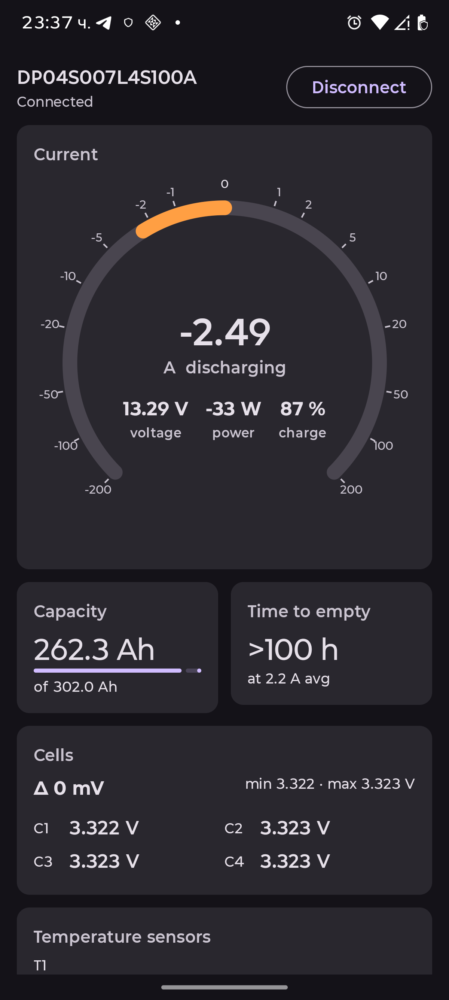
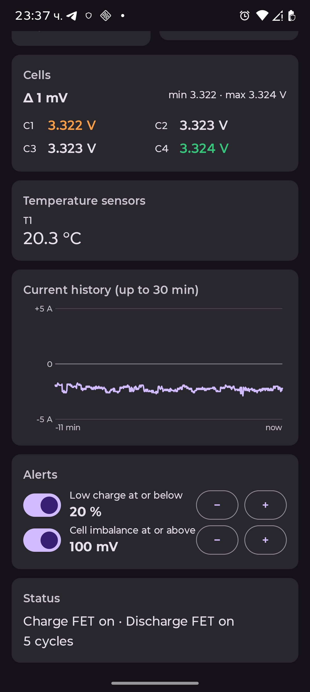
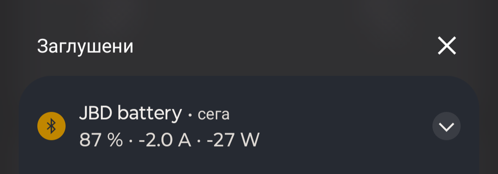

# JBD Battery Monitor

Android app (Kotlin + Jetpack Compose) that reads a JBD / Xiaoxiang BMS over Bluetooth LE and shows:

- battery current on a logarithmic ±200 A gauge (charge right/green, discharge left/orange)
- pack voltage, individual cell voltages, min/max and cell delta, balancing indicators
- power (V × I)
- temperature sensors reported by the BMS
- reported SoC (inside the gauge, with voltage and power) and remaining/nominal Ah
- projected time to full (charging) or empty (discharging), from a ~30 s smoothed current
- alerts (notification + in-app banner) for low SoC and cell imbalance; thresholds are adjustable in the app
- current graph for the last up to 30 minutes since connecting

Protocol: GATT service `FF00`, notify `FF01`, write `FF02`; polls command `0x03` (basic info) and `0x04` (cell voltages) about once a second.
While connected, a foreground service keeps the app running in the background and shows a status notification (SoC, current, power) with a Disconnect button.
The BMS accepts only one BLE connection, so close other JBD apps first.

## Screenshots

<p>
  
  
  
</p>

Left: current gauge (log scale, ±200 A), capacity, time to empty and cells. Middle: cell delta, temperature, current history and alert thresholds.
Right: the status notification that keeps the connection alive in the background.

## Build

```sh
export JAVA_HOME=/opt/homebrew/opt/openjdk@17 ANDROID_HOME=/opt/homebrew/share/android-commandlinetools
./gradlew testDebugUnitTest assembleDebug
adb install -r app/build/outputs/apk/debug/app-debug.apk
```
